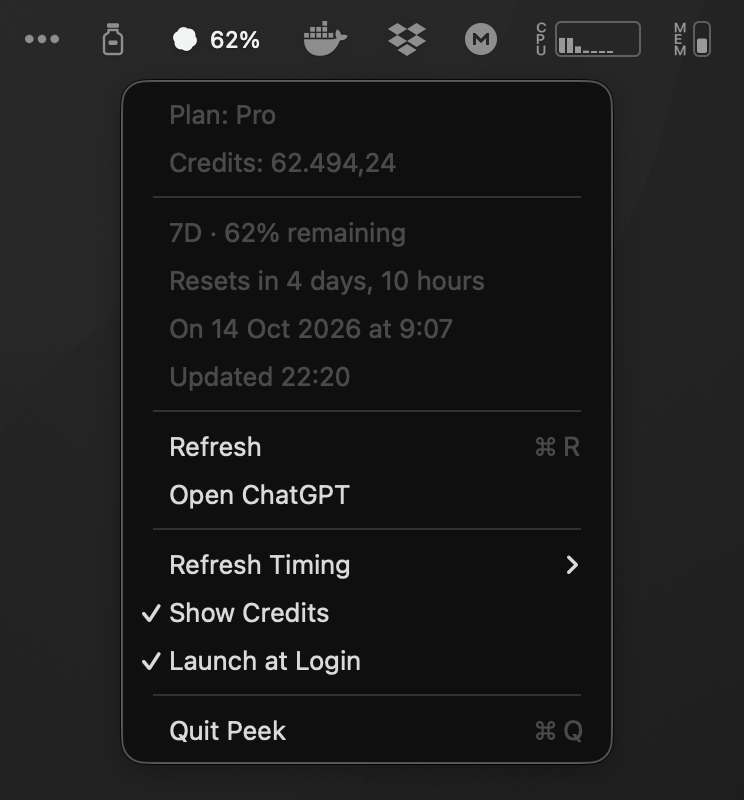
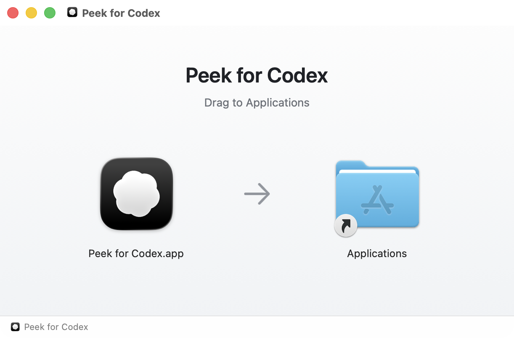

# Peek for Codex

Peek for Codex is a lightweight native macOS menu bar app that keeps current Codex usage one peek away, with optional credits in the menu.

**[Download for macOS](https://github.com/JacopoBassan/Peek-for-Codex/releases/latest/download/Peek-for-Codex.dmg)**



## Why Peek for Codex

- No extra login, API key, or macOS privacy permissions required
- Built specifically for Codex, not a generic AI dashboard
- Native macOS menu bar app, lightweight and always available
- Shows current remaining quota right in the menu bar
- Native menu with checkmarks for preferences
- Optional credits in the menu
- Launch at login support
- Automatic app updates through GitHub Releases
- One running instance, even when opened from another app copy

If you find Peek for Codex useful, consider starring the repo on GitHub

## Requirements

- macOS 14 Sonoma or later
- Codex signed in with your ChatGPT account, through the desktop app or a standalone CLI

The desktop app includes the CLI that Peek uses. You do not need to install it separately. API-key-only sign-in does not provide the ChatGPT usage limits shown by Peek.

## Install the Mac app

The universal DMG installer is **signed and notarized**. It includes Apple Silicon and Intel versions.

1. [Download the DMG](https://github.com/JacopoBassan/Peek-for-Codex/releases/latest/download/Peek-for-Codex.dmg) and open it.
2. Drag **Peek for Codex** to **Applications**.
3. Open Peek for Codex. Its cloud icon appears in the menu bar.



Peek uses your existing Codex sign-in. No additional login is needed.

### Update the app

Peek uses Sparkle to check for updates once per day. **Automatic Updates** in the menu controls automatic checks, downloads and installation. Use **Check for Updates…** to check at any time.

Updates are signed and delivered through GitHub Releases. Your preferences and existing Codex sign-in stay in place.

To update an older copy without Sparkle, or replace the app manually:

1. Choose **Quit Peek** from the menu bar.
2. [Download the latest DMG](https://github.com/JacopoBassan/Peek-for-Codex/releases/latest/download/Peek-for-Codex.dmg) and open it.
3. Drag **Peek for Codex** to **Applications**. Choose **Replace** when Finder asks.
4. Open Peek for Codex again.

## Build from source

Building from source requires a Swift 6 toolchain, such as Xcode 16 or later or matching Xcode Command Line Tools.

If you already use Codex, you can ask it to clone this repo, run `./scripts/install.sh`, and open the installed app from `~/Applications`.

Quit Peek before reinstalling it.

```bash
git clone https://github.com/JacopoBassan/Peek-for-Codex.git
cd Peek-for-Codex
./scripts/install.sh
open ~/Applications/Peek\ for\ Codex.app
```

Maintainers: see [installer packaging and signing](docs/distribution.md).

## How it works

Peek reads account usage through the local Codex CLI using your existing sign-in. Your remaining weekly quota appears beside the cloud icon. Open the menu to see your plan, optional credits, and the reset countdown and date.

The same menu controls refresh timing, credits visibility and launch at login. Settings are saved locally. Peek does not request conversation content.

## Verification

After installing from the DMG, run `"/Applications/Peek for Codex.app/Contents/MacOS/PeekForCodex" --diagnose-usage`. For a source installation, use `~/Applications` instead. It refreshes live usage and prints the menu-bar label and native menu rows, with credit balances redacted. Blank rows represent separators. Checkmarks show enabled preferences and the selected refresh interval. The quota must match the menu-bar percentage. When a reset date is available, its countdown appears above a date row that starts with **On**. A refresh failure exits unsuccessfully.

Maintainers can verify the packaged app with synthetic responses, without using an account:

```sh
./scripts/build.sh
python3 scripts/verify-menu.py
```

This checks countdowns, plan and quota selection, older response formats, empty limits, invalid responses, expired sessions, output limits and request timeouts. It writes a report to `.build/verification/menu/result.json`. See [release checks](docs/release-readiness.md) for the current verification scope and remaining distribution checks.

Packaging uses SwiftPM's `--show-bin-path` to avoid installing a stale executable from an older toolchain's output directory.

## Changelog

### 0.2.1

- Recover from expired reader sign-in using the existing Codex account
- Clear old quota data when a refresh fails

### 0.2.0

- Exact Codex cloud icon in the menu bar
- White cloud glyph with a gradient and Liquid Glass in the app icon
- Native menu with subscription plan, quota and optional credits
- Reset countdown above the exact date
- Native checkmarks for credits and launch at login
- Refresh timing presets in the menu
- Signed and notarized universal DMG with a drag-to-install layout
- Sparkle updates through GitHub Releases, with native menu controls
- Single-instance protection to prevent duplicate menu bar icons
- Correct Codex quota selection and stricter response validation

### 0.1.2

- Cleaner popup architecture
- Smarter popup refresh behavior
- Better Codex app-server error handling

### 0.1.1

- Better expired-session handling
- Clearer popup errors

### 0.1.0

- Initial public release

---

Crafted with Codex, Designed by me

## Disclaimer

The cloud contour comes from OpenAI's Codex vector icon (`codex_new-f14177b03534.svg` in the desktop app). Codex artwork and trademarks belong to OpenAI and are subject to [OpenAI's brand guidelines](https://openai.com/brand/). Peek for Codex is an independent utility.

Automatic updates use [Sparkle](https://sparkle-project.org/), an open-source update framework for macOS. Sparkle is distributed under its [own license](https://github.com/sparkle-project/Sparkle/blob/2.10.0/LICENSE).
